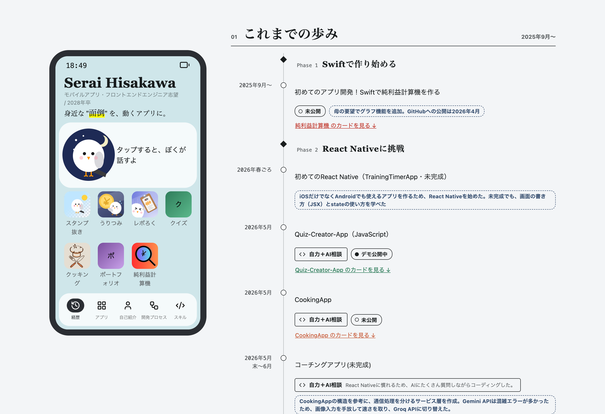
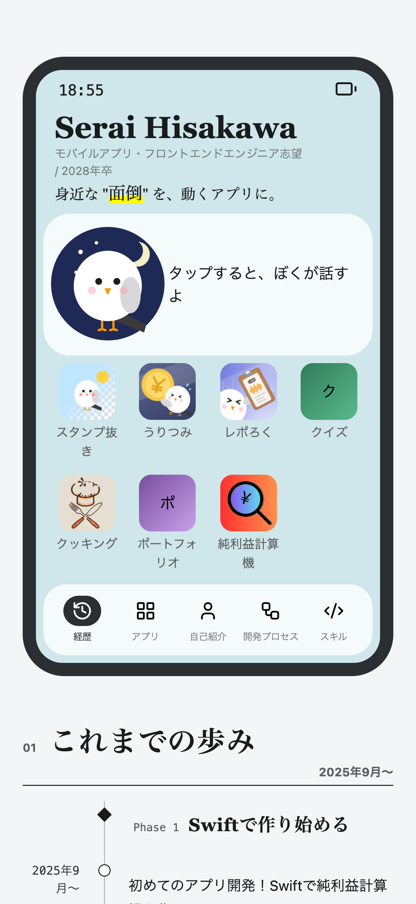

# portfolio

React＋TypeScript で作った、アプリ開発のポートフォリオサイトです。

| | |
| --- | --- |
| サイト | https://portfolio-site-hisakawaserai.vercel.app/ |
| 技術 | React / TypeScript / Vite / lucide-react / react-intersection-observer |
| コード | 自分で書いた（AIはヒントとデザイン案） |
| 作成 | 2026年9月 |

## サイトのスクリーンショット

| PC | スマホ |
| --- | --- |
|  |  |

## 工夫したこと

### 1. 同じ情報を二重に持たない
1つのデータを編集するだけで良くなるため作りました。

年表のデータには `appId` だけを持たせ、アプリの情報は一覧のデータから引いています。AIのコードレビューで二重管理を指摘され、使うデータだけを返す形とアプリを丸ごと返す形を自分で比べたうえで、後者で実装しました。

```ts
// src/utils/getAppCard.ts
export const getApp = (appId: string): AppType | null => {
  const result = apps.find(app => app.id === appId);
  return result ?? null;
}
```

### 2. reduce で3グループに分ける
アプリ一覧を、公開中・デモ・未公開の3グループに分けて表示します。配列を分ける `reduce` は調べて、自分で実装しました。
→ [`src/components/AppGroup/AppGroup.tsx`](src/components/AppGroup/AppGroup.tsx)

### 3. shuffle を最初の1回だけ実行する
目次の鳥のセリフを偏りなく並べ替える `shuffle` を書き、`useState` の初期化関数で最初の1回だけ実行しています。書き方はAIに教わり、自分で実装しました。

```ts
// src/components/TableOfContentsWrapper/TableOfContentsWrapper.tsx
const [talks, setTalks] = useState<string[]>(() => shuffle(initialTalks));
```

### 4. 目次の中の鳥
自己紹介をする、ちょっとしたお遊びで作りました。

スマホ画面をまねた目次の中の鳥を押すと、隣にセリフが表示され、押すたびに次のセリフに進みます（ページ数つき）。

## 自分とAIの役割

**自分**
- サイト全体のコーディング
- props の型（children、state の更新関数など）を調べて定義

**AI**
- Claude Code：どのメソッドを使えばよいかのヒント、コードのレビュー、後から追加した機能の設計（/design。実装は自分）
- Claude Design：スタイルの案（案から選び、自分で写経）
- GitHub Copilot：コミットメッセージの生成（VS Code）

## 使った技術

| 技術 | 使いどころ |
| --- | --- |
| React | サイト全体の画面を、コンポーネントと state で作成 |
| TypeScript | props や state の型を定義 |
| Vite | 開発中の確認用サーバーと、公開用ファイルへのビルド |
| lucide-react | アイコンの表示 |
| react-intersection-observer | useInView で、表示中のセクションを目次に反映／目次が画面の外に出たかを判定 |

## ディレクトリ構成

```
src/
├── components/  画面の部品（1コンポーネント1フォルダ、CSS Modules と型を同じ場所に）
├── data/        アプリ・年表・スキルなど、表示する内容
├── constants/   色やラベルなど、決まった値の対応表
├── hooks/       useIsMobile（画面幅の判定）
└── utils/       getApp・shuffle などの小さな関数
```

## ローカルでの動かし方

```bash
npm install
npm run dev      # 開発サーバー
npm run lint     # ESLint
npm run build    # 型チェック＋ビルド
```